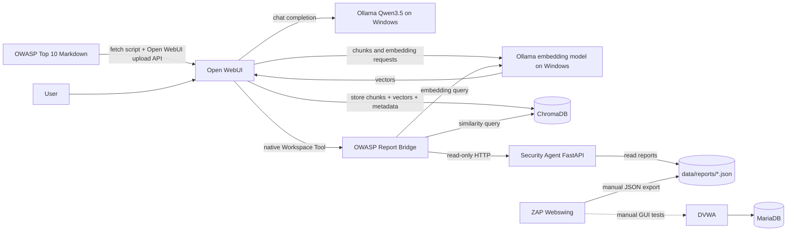

# MGL805 — Local OWASP Security Lab (single Docker Compose)

**A reproducible, human-supervised web-security lab** combining an Open WebUI AI assistant, an external Ollama model server, ChromaDB, a read-only FastAPI reporting agent, OWASP ZAP Webswing, and intentionally vulnerable DVWA with MariaDB. Designed for a small Linux VM (such as `mgl805` on Proxmox) and an Ollama server on a separate GPU-equipped Windows PC.

> **Safety boundary:** Only run this lab against targets you own or have explicit permission to assess. DVWA is intentionally vulnerable. Default ports bind to `127.0.0.1`, not the public Internet. The FastAPI app **cannot launch scans**. ZAP API integration, Nuclei, WireGuard remote VLAN access, and automated CVE ingestion are **not implemented** in this release.

## At a glance

| Service | Role | Where it runs | Default access |
|---|---|---|---|
| Open WebUI | UI, Knowledge Base management, native Python tool bridge | Docker on Linux VM | `http://127.0.0.1:3000` |
| ChromaDB | Stores document chunks, embeddings and metadata | Docker, internal only | `chromadb:8000` (Docker DNS) |
| Security Agent (FastAPI) | Reads existing ZAP reports and checks fixed DVWA target | Docker, internal only | `http://security-agent:8000` (Docker DNS) |
| OWASP ZAP Webswing | Desktop GUI, manual scanning and report export | Docker on Linux VM | `http://127.0.0.1:8088/zap` |
| DVWA | Authorized, intentionally vulnerable training target | Docker on Linux VM | `http://127.0.0.1:4280` |
| MariaDB | Database for DVWA | Docker, internal only | service `db`, port 3306 |
| Ollama | Runs `qwen3.5:9b` and `qwen3-embedding:0.6b` | **Outside Compose**, Windows RTX 3060 12 GB | e.g. `http://192.168.2.157:11434` |

**One Compose file:** [compose.yaml](compose.yaml). One deployment command: `./start.sh`. One checked-in config example: [.env.example](.env.example). A working local **`.env` is included in the download but Git-ignored**; the startup script fills its blank secrets on first run.

### Architecture: read the arrows carefully



**Important architectural distinction:** Open WebUI manages knowledge ingestion (load/upload documents, chunk, ask Ollama for embeddings, store in ChromaDB). For agent investigations, the **Workspace Tool** also supports a separate, explicit similarity search by embedding the question with Ollama and querying ChromaDB; we use this path because the local model previously skipped custom tool calls when a large knowledge collection was attached automatically.

## Prerequisites

- Linux VM with Docker Engine, Docker Compose v2, `bash`, Python 3.10+, `git`, and `openssl` (or Python 3 for secret generation).
- Windows machine running Ollama, reachable **from the Linux VM and from the Open WebUI container**. Installed models: `qwen3.5:9b` and `qwen3-embedding:0.6b`.
- Capacity for Open WebUI, ChromaDB, ZAP, DVWA, MariaDB. The model's GPU/VRAM is on Windows, not assigned to the Docker VM.
- Permission to run and retain vulnerability test reports.
- **Do not place this alongside your existing Portainer stacks without migration planning.** The host ports `3000`, `8088`, `4280` and containers with similar functions may already be running. This is a new all-in-one Compose deployment, not an in-place update.

## 1. Configure Ollama on Windows

On Windows PowerShell:

```powershell
ollama list
ollama ps
curl.exe http://127.0.0.1:11434/api/tags
```

Ensure Ollama listens on a trusted network interface (usually by setting `OLLAMA_HOST=0.0.0.0:11434` for its Windows process and restarting Ollama) **and restrict port 11434 in Windows Firewall to your Linux VM's IP**. Do not publicly expose the Ollama API.

Check the PC's current IPv4 address. Update `OLLAMA_URL` in `.env` if it changed. `No route to host` or `Model not found` from Open WebUI can reflect an unreachable Windows machine rather than a missing model.

From the Linux host:

```bash
curl --max-time 8 http://192.168.2.157:11434/api/tags
python3 scripts/check_ollama.py
```

If the model is missing on Windows, install it there (`ollama pull qwen3.5:9b` and `ollama pull qwen3-embedding:0.6b`). This Compose project deliberately **does not install a second Ollama on Linux**.

## 2. Deploy everything in Docker

```bash
# From the repository root
chmod +x start.sh stop.sh scripts/*.sh
cp -n .env.example .env  # only needed when .env is absent
nano .env                 # set OLLAMA_URL; keep BIND_IP=127.0.0.1 initially
./start.sh --check-only   # prepares .env and validates Compose syntax
./start.sh
```

`start.sh` creates the persistent directories, generates `WEBUI_SECRET_KEY`, `DB_PASSWORD`, and `DB_ROOT_PASSWORD` if empty, validates Compose, builds FastAPI, and starts all six Docker services. It **never deletes old containers or volumes**. On first deployment the Docker image pulls may take time. If your user currently needs `sudo docker`, either run `sudo ./start.sh` (then check bind mount ownership) or configure a dedicated deployment account for Docker. Membership in the `docker` group grants root-equivalent access; do not add untrusted users.

A startup failure on ports 3000/8088/4280 means something else is already bound there. Stop/migrate the OLD stack carefully or set different ports in `.env` before retrying. Do not destroy existing Open WebUI/Chroma data unless you have an independently tested backup.

Default web UIs are **host-only**. From your workstation use SSH port forwarding, for example:

```bash
ssh -L 3000:127.0.0.1:3000 -L 8088:127.0.0.1:8088 -L 4280:127.0.0.1:4280 user@YOUR_VM_IP
```

Then browse to `http://localhost:3000`, `http://localhost:8088/zap`, and `http://localhost:4280`. For LAN access instead, set `BIND_IP=YOUR_VM_LAN_IP` in `.env` and rerun `./start.sh`, only when your LAN and firewall rules are trusted.

Inspect services:

```bash
docker compose ps
docker compose logs --tail=100 open-webui
./scripts/check_stack.sh
```

## 3. First-time setup of DVWA and ZAP

1. Open DVWA at `http://localhost:4280` (or your SSH-forwarded port), log in with the **DVWA training defaults** shown by its setup page (typically `admin` / `password`), open **Setup DVWA**, and click **Create / Reset Database**. Do not use real credentials.
2. Open ZAP Webswing at `http://localhost:8088/zap` and **wait for the GUI to start**; Webswing launches ZAP when its UI is accessed.
3. Configure ZAP's target to `http://dvwa/` **inside the Docker network**, not `localhost:4280`. ZAP and DVWA share the `lab` network.
4. Run **manual, authorized** scans inside the lab. Avoid aggressive scans against other hosts.
5. **Export ZAP JSON** via its report menu into the container path `/zap/wrk/reports/2026-...-ZAP-Report-dvwa.json`. The host sees this same file as `./data/reports/2026-...-ZAP-Report-dvwa.json`. HTML reports are fine for humans, but the FastAPI reader selects `*.json` only.
6. Alternatively, if you generated a report somewhere else, import it with `python3 scripts/import_zap_report.py /path/to/ZAP-Report.json` (validation + copy).

**Critical report path:** `./data/reports/*.json` is mounted as `/reports:ro` in FastAPI and `/zap/wrk/reports:rw` in ZAP. `./data/zap/` is a **different** volume containing ZAP's root CA files, including the private `zap_root_ca.key`. Never commit or share it.

**Known limitation:** the Webswing API/proxy should listen on 8090 internally, but in the earlier lab it closed HTTP requests. This stack does not assume that problem is solved and **does not expose or use port 8090**. You can manually inspect ZAP's API from the browser GUI and run `./scripts/check_zap_api.sh` (read-only version request, prompted key). Do not enable unrestricted API access.

If ZAP cannot write reports due to permissions, check ownership:

```bash
docker compose exec zap id
ls -ld data/zap data/reports
# Only if needed: grant ownership to the UID/GID shown by 'docker compose exec zap id'.
# Example when both are 1000:1000:
# sudo chown -R 1000:1000 data/zap data/reports
```

Do **not** run `chmod -R 777`.

## 4. Configure Open WebUI + Ollama embeddings

Open `http://localhost:3000`. Create the first admin account (register only trusted users; disable further registration in Admin settings when done). Go to **Admin Panel → Settings → Documents** or the corresponding current Knowledge/RAG settings and verify:

- **Embedding engine** = `Ollama`.
- **Embedding model** = `qwen3-embedding:0.6b`.
- **Vector store** = external ChromaDB at `chromadb:8000` (provided at server startup by `VECTOR_DB=chroma`, `CHROMA_HTTP_HOST=chromadb`, `CHROMA_HTTP_PORT=8000`).
- **Model connection** = `OLLAMA_URL` from `.env`, pointing to Windows.

The environment variables in Compose seed these defaults; **Open WebUI can persist later changes in its UI**, which may override the environment. Verify the actual settings after configuration changes. We must use the same embedding model when indexing and searching; the current Qwen embedding produces 1024-dimensional vectors.

## 5. Create the OWASP knowledge base, then import documents

1. In **Workspace → Knowledge → Create**, create a collection named **OWASP Security Knowledge**.
2. Copy its **Knowledge ID / UUID** from Open WebUI (or its API/UI URL). New deployments have a new ID; **do not reuse** `cf7eb73b-...` from the old lab.
3. In Open WebUI **Settings → Account**, create an API key with permission to upload and manage knowledge. Store it in `.env` as `OPENWEBUI_API_KEY=...`. Restrict file permissions: `chmod 600 .env`.
4. Set `KNOWLEDGE_ID=...` in `.env`, then recreate Open WebUI so the manual bridge sees the collection ID:

```bash
docker compose up -d --no-deps --force-recreate open-webui
```

5. Download the **10 official OWASP Top 10:2025 chapter Markdown files** and load them **through Open WebUI's API**:

```bash
./scripts/install-tools.sh
python3 scripts/fetch_owasp_top10.py
.venv/bin/python scripts/load_knowledge.py --dry-run
.venv/bin/python scripts/load_knowledge.py
```

The loader uploads each file to `/api/v1/files/`, polls `/api/v1/files/{id}/process/status` until `completed`, then links it with `/api/v1/knowledge/{knowledge_id}/file/add`. **Open WebUI**, not the loader, chunks the Markdown and calls Ollama to generate embeddings and store vectors/chunks/metadata in ChromaDB. The loader keeps a local SHA256 manifest under `data/state/knowledge_uploads.json` to skip unchanged, previously successful uploads. If you delete/recreate the knowledge base, update `KNOWLEDGE_ID`; `--force` retries but can trigger duplicate-content errors.

Important: the ten Markdown files do **not** imply ten chunks. Chunk counts depend on the active Open WebUI chunking configuration and document contents. The **161 chunks** observed in our earlier lab are not a guaranteed number for a fresh deployment.

Test the actual collection using:

```bash
python3 scripts/check_chroma.py
python3 scripts/check_chroma.py --query 'SQL injection CWE-89 prevention'
```

This runs inside the Open WebUI container (which contains the Chroma client), so **the Chroma port remains internal**.

## 6. Install the working Open WebUI native tool (manual)

1. Open **Workspace → Tools → Create Tool**.
2. Paste **the complete source of** [`openwebui/tools/owasp_report_bridge.py`](openwebui/tools/owasp_report_bridge.py).
3. Name it **OWASP Report Bridge**, save, and enable it for your chat/model.
4. Select `qwen3.5:9b` and choose **Function Calling = Native** under the model's advanced settings.
5. **Disable Builtin Tools on that model profile** for initial testing. In our lab, builtin Calendar/Memory/Notes/Skills definitions competed with the custom tools. Use a dedicated **OWASP Security Agent** profile rather than globally disabling functionality for unrelated chats.
6. Do not attach the entire OWASP knowledge collection automatically while testing tool calling; the explicit `search_owasp_knowledge` tool is part of the bridge.

The four tested function names are: `summarize_latest_zap_report`, `list_zap_findings`, `get_zap_finding`, `search_owasp_knowledge`. The bridge connects to `http://security-agent:8000`, `chromadb:8000`, and the Windows Ollama endpoint using the environment values supplied by Compose.

**Suggested test:**

> Call `list_zap_findings` with severity High. Retrieve a real SQL Injection finding via `get_zap_finding` using the returned ID. Call `search_owasp_knowledge` for SQL injection and CWE-89. Report risk and scanner confidence separately, distinguish ZAP observations from independently verified vulnerabilities, and cite only passages actually retrieved.

## 7. FastAPI service and ZAP report verification

All FastAPI source is checked in under [`services/security-agent/`](services/security-agent/) with its own [`Dockerfile`](services/security-agent/Dockerfile) and requirements. No FastAPI host port is published.

From **inside** Open WebUI:

```bash
docker compose exec -T open-webui python -c 'import urllib.request; print(urllib.request.urlopen("http://security-agent:8000/reports/latest/summary").read().decode()[:1500])'
```

This reads the **latest JSON file by modification time** in `data/reports/`. If there are no reports, a 404 is expected, not a deployment failure. The API also provides `GET /reports`, `/reports/latest/findings`, `/reports/latest/findings/{finding_id}`, and `/target/status` (fixed DVWA URL). It cannot scan arbitrary URLs or access arbitrary files.

Inspect an individual report locally:

```bash
python3 scripts/summarize_zap_report.py
python3 scripts/summarize_zap_report.py data/reports/your-report.json
```

## 8. Utility scripts and common commands

| Command | What it does | Dependencies / caveats |
|---|---|---|
| `./start.sh` | First startup, secret generation, Compose validation, build and run | Docker Compose + openssl/Python |
| `./start.sh --check-only` | Generate missing secrets and validate Compose YAML | Does not start containers |
| `./stop.sh` | Stop all Compose containers without deleting data | Stop only, no `down -v` |
| `./scripts/check_stack.sh` | Show container states and verify Open WebUI, Chroma, agent, Ollama and DVWA | Read-only; services must be running |
| `python3 scripts/fetch_owasp_top10.py` | Download 10 OWASP 2025 Markdown chapters from official GitHub | Internet and Python 3 |
| `python3 scripts/check_ollama.py` | Check Ollama API, installed and loaded models | Windows Ollama reachable via VPN/LAN |
| `.venv/bin/python scripts/load_knowledge.py` | Upload documents via authenticated Open WebUI API, poll, link to KB, skip via manifest | `.env` API key + Knowledge ID |
| `python3 scripts/check_chroma.py` | List Chroma collections and counts | Running Open WebUI container |
| `python3 scripts/check_chroma.py --query 'CWE-89'` | Embedding dimensions and Top-3 semantic search | Windows Ollama reachable |
| `python3 scripts/import_zap_report.py PATH.json` | Validate/copy a report to `data/reports` | No scanning or network |
| `python3 scripts/summarize_zap_report.py [PATH]` | Offline report alert counts and severities | No scanning or network |
| `./scripts/check_zap_api.sh` | Test read-only ZAP API version with interactive key | API may still be inaccessible |
| `./scripts/backup.sh --yes` | Consistent backup: stops, archives `.env` + `data`, restarts | Archive contains secrets, handle securely |
| `./scripts/install-tools.sh` | Local Python venv for importer and tests | Python venv + pip |
| `./scripts/run-tests.sh` | Run synthetic, offline API tests | pytest/httpx installed |

Quick operational cheatsheet:

```bash
docker compose ps
docker compose logs -f --tail=100 security-agent
docker compose logs -f --tail=100 open-webui
docker compose restart open-webui
./scripts/check_stack.sh
./scripts/backup.sh --yes
```

## 9. Files and persistence

```text
mgl805-security-lab-compose/
├── compose.yaml                     ONE Docker Compose configuration
├── .env / .env.example             local secrets / documented defaults
├── start.sh / stop.sh              start + stop
├── services/security-agent/        FastAPI read-only service + Dockerfile
├── openwebui/tools/                4-function manual Workspace Tool
├── scripts/                        helper utilities (see table)
├── knowledge/owasp-top10-2025/     downloaded OWASP official Markdown files
├── data/
│   ├── openwebui/                 accounts, chat settings, knowledge metadata
│   ├── chroma/                    persistent Chroma vector index
│   ├── mariadb/                   DVWA MariaDB state
│   ├── zap/                       ZAP working dir & PRIVATE ZAP root CA key
│   ├── reports/                   ZAP JSON exports consumed by FastAPI
│   └── state/                     local knowledge upload manifest
├── backups/                        sensitive archive snapshots
├── tests/                          synthetic fixtures, no live targets
└── docs/                           architecture, security, troubleshooting, plans
```

All `data/`, `backups/`, `.env`, and key files are Git-ignored. This repo intentionally does **not** include your previous live ZAP JSON reports, API keys, Windows passwords, SSH private keys or WireGuard configurations.

## 10. Security, maintenance and limitations

- **Do not use DVWA on a routable/public host.** Default bind is `127.0.0.1`. The two Docker networks `lab` and `dbnet` are internal; the API/DB/vector ports have no host publication.
- Protect `.env`, ZAP CA private key, scan evidence and backups. Never commit secrets or real reports.
- Keep the Security Agent read-only. Scanner alerts have severity and confidence and are **not independently confirmed vulnerabilities**.
- Manual ZAP scans are supported through the GUI. We are not claiming that ZAP's API is usable until its access restrictions and request handling are validated.
- `Nuclei`, WireGuard remote targets, automated ZAP scan orchestration, CVE/NVD/CISA/EPSS collection and scheduled index refresh are **future work**, not magically deployed by this Compose file.
- On a real shared deployment, pin all floating image tags to verified versions or digests and review the Docker network boundary, access logs and resource limits.
- This archive has been validated for syntax and tested with offline synthetic fixtures. It has **not** been launched against your Proxmox VM from here; complete runtime verification on `mgl805` is still needed.

Additional details: [Architecture](docs/ARCHITECTURE.md) · [Operations and troubleshooting](docs/OPERATIONS.md) · [Security](docs/SECURITY.md) · [Roadmap](docs/ROADMAP.md).

### Official documentation links

- [Open WebUI environment variables](https://docs.openwebui.com/reference/env-configuration/)
- [Open WebUI knowledge API and ingestion](https://docs.openwebui.com/features/workspace/knowledge/)
- [Open WebUI API endpoints](https://docs.openwebui.com/reference/api-endpoints/)
- [OWASP ZAP Webswing Docker documentation](https://www.zaproxy.org/docs/docker/webswing/)
- [DVWA official Docker Compose](https://github.com/digininja/DVWA/blob/master/compose.yml)
- [ChromaDB health checks](https://cookbook.chromadb.dev/running/health-checks/)
- [OWASP Top 10:2025 official Markdown](https://github.com/OWASP/Top10/tree/master/2025/docs/en)
