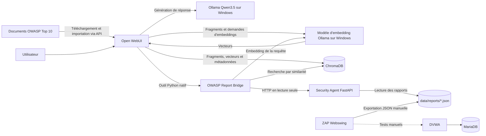

# MGL805 — Laboratoire local de sécurité OWASP (un seul Docker Compose)

**Un laboratoire de sécurité web reproductible, avec supervision humaine**, réunissant un assistant IA Open WebUI, un serveur de modèles Ollama externe, ChromaDB, un agent de consultation de rapports FastAPI en lecture seule, OWASP ZAP Webswing et l'application volontairement vulnérable DVWA avec MariaDB. L'ensemble est conçu pour une petite VM Linux (comme `mgl805` sur Proxmox), avec un serveur Ollama exécuté sur un PC Windows distinct équipé d'un GPU.

> **Périmètre de sécurité :** n'utilisez ce laboratoire que sur des cibles dont vous êtes propriétaire ou pour lesquelles vous disposez d'une autorisation explicite. DVWA est volontairement vulnérable. Par défaut, les ports sont liés à `127.0.0.1`, et non à Internet. L'application FastAPI **ne peut pas lancer de scans**. L'intégration de l'API ZAP, Nuclei, l'accès à un VLAN distant par WireGuard et l'ingestion automatisée des CVE **ne sont pas implémentés** dans cette version.

## Vue d'ensemble

| Service | Rôle | Emplacement | Accès par défaut |
|---|---|---|---|
| Open WebUI | Interface utilisateur, gestion de la base de connaissances, pont d'outils Python natif | Docker sur la VM Linux | `http://127.0.0.1:3000` |
| ChromaDB | Stockage des fragments documentaires, embeddings et métadonnées | Docker, réseau interne uniquement | `chromadb:8000` (DNS Docker) |
| Security Agent (FastAPI) | Lecture des rapports ZAP existants et vérification de la cible DVWA prédéfinie | Docker, réseau interne uniquement | `http://security-agent:8000` (DNS Docker) |
| OWASP ZAP Webswing | Interface graphique de ZAP, scans manuels et exportation des rapports | Docker sur la VM Linux | `http://127.0.0.1:8088/zap` |
| DVWA | Application d'entraînement volontairement vulnérable et autorisée | Docker sur la VM Linux | `http://127.0.0.1:4280` |
| MariaDB | Base de données de DVWA | Docker, réseau interne uniquement | service `db`, port 3306 |
| Ollama | Exécution de `qwen3.5:9b` et `qwen3-embedding:0.6b` | **Hors de Compose**, sur Windows avec RTX 3060 12 Go | par ex. `http://192.168.2.157:11434` |

**Un seul fichier Compose :** [compose.yaml](compose.yaml). Une seule commande de déploiement : `./start.sh`. Un modèle de configuration versionné : [.env.example](.env.example). Un fichier local **`.env` est fourni dans l'archive téléchargée, mais est ignoré par Git** ; le script de démarrage génère les secrets manquants lors de la première exécution.

### Architecture : bien suivre le sens des flèches



**Distinction architecturale importante :** Open WebUI gère l'ingestion des connaissances (chargement des documents, découpage en fragments, demande d'embeddings à Ollama, stockage dans ChromaDB). Lors des investigations de l'agent, l'**outil de l'espace de travail (Workspace Tool)** permet également une recherche explicite par similarité : il demande à Ollama d'encoder la question, puis interroge ChromaDB. Nous utilisons ce deuxième chemin, car le modèle local avait parfois ignoré les appels d'outils personnalisés lorsqu'une collection volumineuse était automatiquement jointe à la conversation.

## Prérequis

- VM Linux avec Docker Engine, Docker Compose v2, `bash`, Python 3.10 ou supérieur, `git` et `openssl` (ou Python 3 pour la génération des secrets).
- Machine Windows exécutant Ollama, accessible **depuis la VM Linux et depuis le conteneur Open WebUI**. Modèles installés : `qwen3.5:9b` et `qwen3-embedding:0.6b`.
- Ressources suffisantes pour Open WebUI, ChromaDB, ZAP, DVWA et MariaDB. Le GPU et sa VRAM sont sur Windows et ne sont pas attribués à la VM Docker.
- Autorisation d'effectuer les tests de vulnérabilités et de conserver leurs rapports.
- **Ne déployez pas ce projet à côté de vos stacks Portainer existantes sans planifier une migration.** Les ports hôtes `3000`, `8088` et `4280`, ainsi que des conteneurs jouant les mêmes rôles, peuvent déjà être utilisés. Ce projet est un nouveau déploiement Compose tout-en-un, pas une mise à jour sur place.

## 1. Configurer Ollama sur Windows

Dans PowerShell sur Windows :

```powershell
ollama list
ollama ps
curl.exe http://127.0.0.1:11434/api/tags
```

Vérifiez qu'Ollama écoute sur une interface réseau de confiance (généralement en configurant `OLLAMA_HOST=0.0.0.0:11434` pour le processus Windows, puis en redémarrant Ollama) **et limitez l'accès au port 11434 dans le Pare-feu Windows à l'adresse IP de votre VM Linux**. N'exposez jamais l'API Ollama publiquement.

Vérifiez l'adresse IPv4 actuelle du PC. Si elle a changé, modifiez `OLLAMA_URL` dans `.env`. Une erreur `No route to host` ou `Model not found` dans Open WebUI peut indiquer que la machine Windows est inaccessible plutôt que l'absence du modèle.

Depuis l'hôte Linux :

```bash
curl --max-time 8 http://192.168.2.157:11434/api/tags
python3 scripts/check_ollama.py
```

Si un modèle manque sur Windows, installez-le sur cette machine (`ollama pull qwen3.5:9b` et `ollama pull qwen3-embedding:0.6b`). Ce projet Compose **n'installe volontairement pas un second serveur Ollama sur Linux**.

## 2. Déployer tous les services avec Docker

```bash
# Depuis la racine du dépôt
chmod +x start.sh stop.sh scripts/*.sh
cp -n .env.example .env  # seulement si .env est absent
nano .env                 # définir OLLAMA_URL ; garder BIND_IP=127.0.0.1 au départ
./start.sh --check-only   # prépare .env et valide la syntaxe Compose
./start.sh
```

`start.sh` crée les répertoires persistants, génère `WEBUI_SECRET_KEY`, `DB_PASSWORD` et `DB_ROOT_PASSWORD` si ces valeurs sont vides, valide la configuration Compose, construit l'image FastAPI et démarre les six services Docker. Il **ne supprime jamais les anciens conteneurs ni les volumes**. Au premier déploiement, le téléchargement des images Docker peut prendre du temps. Si votre compte nécessite actuellement `sudo docker`, vous pouvez utiliser `sudo ./start.sh` (puis vérifier les propriétaires des répertoires montés) ou configurer un compte dédié au déploiement. L'appartenance au groupe `docker` donne des privilèges équivalents à ceux de `root` : n'y ajoutez pas des utilisateurs non fiables.

Si le démarrage échoue sur les ports 3000, 8088 ou 4280, un autre service utilise déjà ces ports. Arrêtez ou migrez **l'ancien stack** avec précaution, ou changez les ports dans `.env` avant de réessayer. Ne détruisez pas les données Open WebUI/ChromaDB existantes sans une sauvegarde indépendante dont la restauration a été testée.

Par défaut, les interfaces web ne sont accessibles **que depuis l'hôte**. Depuis votre poste de travail, utilisez par exemple un transfert de ports SSH :

```bash
ssh -L 3000:127.0.0.1:3000 -L 8088:127.0.0.1:8088 -L 4280:127.0.0.1:4280 user@YOUR_VM_IP
```

Ouvrez ensuite `http://localhost:3000`, `http://localhost:8088/zap` et `http://localhost:4280`. Si vous préférez un accès sur le LAN, définissez `BIND_IP=YOUR_VM_LAN_IP` dans `.env`, puis relancez `./start.sh`, uniquement si le réseau local et les règles de pare-feu sont fiables.

Pour inspecter les services :

```bash
docker compose ps
docker compose logs --tail=100 open-webui
./scripts/check_stack.sh
```

## 3. Première configuration de DVWA et ZAP

1. Ouvrez DVWA à `http://localhost:4280` (ou sur le port transféré par SSH), connectez-vous avec les **identifiants de formation par défaut de DVWA** indiqués sur sa page de configuration (généralement `admin` / `password`), ouvrez **Setup DVWA**, puis cliquez sur **Create / Reset Database**. N'utilisez jamais de vrais identifiants.
2. Ouvrez ZAP Webswing à `http://localhost:8088/zap` et **attendez le démarrage de l'interface graphique** ; Webswing lance ZAP lorsque son interface est ouverte.
3. Dans ZAP, définissez la cible comme `http://dvwa/` **à l'intérieur du réseau Docker**, et non `localhost:4280`. ZAP et DVWA partagent le réseau `lab`.
4. Exécutez des scans **manuels et autorisés** à l'intérieur du laboratoire. Évitez les analyses agressives sur d'autres machines.
5. **Exportez un rapport JSON de ZAP** à partir du menu des rapports, dans le conteneur, vers `/zap/wrk/reports/2026-...-ZAP-Report-dvwa.json`. Sur l'hôte, le même fichier se trouve dans `./data/reports/2026-...-ZAP-Report-dvwa.json`. Les rapports HTML peuvent servir à la lecture humaine, mais FastAPI ne sélectionne que les fichiers `*.json`.
6. Si un rapport a été créé ailleurs, importez-le plutôt avec `python3 scripts/import_zap_report.py /path/to/ZAP-Report.json` (validation et copie).

**Chemin essentiel des rapports :** `./data/reports/*.json` est monté sur `/reports:ro` dans FastAPI et sur `/zap/wrk/reports:rw` dans ZAP. `./data/zap/` est un volume **distinct** contenant les fichiers de l'autorité de certification racine de ZAP, notamment la clé privée `zap_root_ca.key`. Ne la publiez et ne la versionnez jamais.

**Limite connue :** l'API/le proxy de Webswing devrait écouter sur le port interne 8090, mais dans le laboratoire précédent, cette connexion HTTP était fermée par le serveur. Ce projet ne suppose pas que le problème soit résolu et **n'expose ni n'utilise le port 8090**. Vous pouvez examiner les paramètres de l'API ZAP depuis l'interface graphique et exécuter `./scripts/check_zap_api.sh` (requête de version en lecture seule, avec saisie interactive de la clé). N'activez pas d'accès API non restreint.

Si ZAP ne peut pas écrire les rapports à cause des permissions, vérifiez les propriétaires :

```bash
docker compose exec zap id
ls -ld data/zap data/reports
# Seulement si nécessaire : attribuer les droits à l'UID/GID indiqué par 'docker compose exec zap id'.
# Exemple si les deux valent 1000:1000 :
# sudo chown -R 1000:1000 data/zap data/reports
```

**N'exécutez pas** `chmod -R 777`.

## 4. Configurer Open WebUI et les embeddings Ollama

Ouvrez `http://localhost:3000`. Créez le premier compte administrateur (n'inscrivez que des personnes de confiance et désactivez ensuite les inscriptions dans les paramètres d'administration). Accédez à **Admin Panel → Settings → Documents**, ou aux paramètres équivalents de connaissances/RAG dans votre version, puis vérifiez :

- **Moteur d'embedding** = `Ollama`.
- **Modèle d'embedding** = `qwen3-embedding:0.6b`.
- **Stockage vectoriel** = ChromaDB externe, accessible à `chromadb:8000` (paramétré au démarrage du serveur par `VECTOR_DB=chroma`, `CHROMA_HTTP_HOST=chromadb`, `CHROMA_HTTP_PORT=8000`).
- **Connexion au modèle** = `OLLAMA_URL` dans `.env`, pointant vers Windows.

Les variables d'environnement de Compose fournissent les paramètres initiaux ; **Open WebUI peut enregistrer ultérieurement des modifications effectuées dans son interface**, lesquelles peuvent prendre le dessus sur ces variables. Vérifiez les paramètres réellement actifs après toute modification. Le même modèle d'embedding doit être utilisé lors de l'indexation et de la recherche. Le modèle Qwen utilisé ici produit des vecteurs de 1 024 dimensions.

## 5. Créer la base de connaissances OWASP, puis importer les documents

1. Dans **Workspace → Knowledge → Create**, créez une collection appelée **OWASP Security Knowledge**.
2. Copiez son **Knowledge ID / UUID** depuis Open WebUI (ou son URL/API). Un nouveau déploiement crée un nouvel identifiant : **ne réutilisez pas** `cf7eb73b-...` provenant de l'ancien laboratoire.
3. Dans **Settings → Account** d'Open WebUI, générez une clé API autorisant l'importation des fichiers et l'administration des connaissances. Enregistrez-la dans `.env` sous `OPENWEBUI_API_KEY=...`. Limitez les permissions du fichier : `chmod 600 .env`.
4. Renseignez `KNOWLEDGE_ID=...` dans `.env`, puis recréez Open WebUI pour que le pont manuel voie l'identifiant de la collection :

```bash
docker compose up -d --no-deps --force-recreate open-webui
```

5. Téléchargez les **10 fichiers Markdown officiels des chapitres OWASP Top 10:2025**, puis chargez-les **par l'API d'Open WebUI** :

```bash
./scripts/install-tools.sh
python3 scripts/fetch_owasp_top10.py
.venv/bin/python scripts/load_knowledge.py --dry-run
.venv/bin/python scripts/load_knowledge.py
```

Le script envoie chaque fichier vers `/api/v1/files/`, interroge `/api/v1/files/{id}/process/status` jusqu'à obtenir `completed`, puis associe le fichier à la collection par `/api/v1/knowledge/{knowledge_id}/file/add`. C'est **Open WebUI**, et non le script, qui découpe le Markdown en fragments, sollicite Ollama pour les embeddings et écrit les vecteurs, fragments et métadonnées dans ChromaDB. Le script conserve un manifeste local SHA-256 dans `data/state/knowledge_uploads.json` afin d'ignorer les fichiers inchangés déjà importés avec succès. Si vous supprimez et recréez la base de connaissances, mettez `KNOWLEDGE_ID` à jour ; l'option `--force` permet une nouvelle tentative, mais peut déclencher des erreurs de contenu dupliqué.

Attention : **dix fichiers Markdown ne signifient pas dix fragments**. Leur nombre dépend des paramètres de découpage d'Open WebUI et du contenu des documents. Les **161 fragments** observés dans l'ancien laboratoire ne constituent pas un résultat garanti pour un nouveau déploiement.

Vérifiez la collection réelle :

```bash
python3 scripts/check_chroma.py
python3 scripts/check_chroma.py --query 'SQL injection CWE-89 prevention'
```

Ce script s'exécute depuis le conteneur Open WebUI (qui possède le client ChromaDB) : **le port ChromaDB reste donc interne**.

## 6. Installer l'outil natif Open WebUI déjà validé (manuellement)

1. Ouvrez **Workspace → Tools → Create Tool**.
2. Collez **l'intégralité du code** de [`openwebui/tools/owasp_report_bridge.py`](openwebui/tools/owasp_report_bridge.py).
3. Nommez-le **OWASP Report Bridge**, enregistrez-le et activez-le pour la conversation ou le modèle.
4. Sélectionnez `qwen3.5:9b` et réglez **Function Calling = Native** dans les paramètres avancés du modèle.
5. **Désactivez Builtin Tools dans ce profil de modèle** lors des premiers tests. Dans notre laboratoire, les fonctions intégrées Calendar/Memory/Notes/Skills entraient en concurrence avec les outils personnalisés. Utilisez un profil **OWASP Security Agent** dédié plutôt que de désactiver globalement ces fonctionnalités pour toutes les conversations.
6. N'attachez pas automatiquement l'ensemble de la collection OWASP pendant les essais d'appels d'outils : la recherche explicite `search_owasp_knowledge` est déjà disponible dans le pont.

Les quatre fonctions validées sont `summarize_latest_zap_report`, `list_zap_findings`, `get_zap_finding` et `search_owasp_knowledge`. Le pont utilise `http://security-agent:8000`, `chromadb:8000` et le point de terminaison Ollama sur Windows, grâce aux valeurs d'environnement fournies par Compose.

**Exemple de demande pour vérifier l'agent :**

> Appelle `list_zap_findings` avec la sévérité `High`. Récupère une véritable alerte d'injection SQL avec `get_zap_finding`, en utilisant l'identifiant retourné. Appelle `search_owasp_knowledge` pour les injections SQL et CWE-89. Présente séparément le risque et la confiance du scanner, distingue les observations ZAP des vulnérabilités confirmées indépendamment, et cite uniquement les passages réellement récupérés.

## 7. Service FastAPI et vérification des rapports ZAP

Tout le code source FastAPI se trouve dans [`services/security-agent/`](services/security-agent/), avec son propre [`Dockerfile`](services/security-agent/Dockerfile) et ses dépendances. Aucun port FastAPI n'est publié sur l'hôte.

Depuis **l'intérieur d'Open WebUI** :

```bash
docker compose exec -T open-webui python -c 'import urllib.request; print(urllib.request.urlopen("http://security-agent:8000/reports/latest/summary").read().decode()[:1500])'
```

Cette commande lit le **fichier JSON le plus récent selon sa date de modification** dans `data/reports/`. En l'absence de rapports, une réponse HTTP 404 est normale et n'indique pas un échec du déploiement. L'API propose aussi `GET /reports`, `/reports/latest/findings`, `/reports/latest/findings/{finding_id}` et `/target/status` (URL DVWA prédéfinie). Elle ne permet pas de scanner des URL arbitraires ni de lire des fichiers quelconques.

Pour examiner un rapport localement :

```bash
python3 scripts/summarize_zap_report.py
python3 scripts/summarize_zap_report.py data/reports/your-report.json
```

## 8. Scripts utilitaires et commandes courantes

| Commande | Fonction | Dépendances / remarques |
|---|---|---|
| `./start.sh` | Premier démarrage, génération des secrets, validation Compose, construction et lancement | Docker Compose + openssl/Python |
| `./start.sh --check-only` | Génère les secrets manquants et valide le YAML Compose | Ne démarre pas les conteneurs |
| `./stop.sh` | Arrête les conteneurs Compose sans supprimer les données | Arrêt uniquement, pas de `down -v` |
| `./scripts/check_stack.sh` | Affiche l'état des conteneurs et vérifie Open WebUI, ChromaDB, l'agent, Ollama et DVWA | Lecture seule ; services démarrés |
| `python3 scripts/fetch_owasp_top10.py` | Télécharge les 10 chapitres Markdown OWASP 2025 depuis le dépôt GitHub officiel | Internet et Python 3 |
| `python3 scripts/check_ollama.py` | Vérifie l'API Ollama et les modèles installés/chargés | Ollama Windows accessible par VPN/LAN |
| `.venv/bin/python scripts/load_knowledge.py` | Charge les documents par l'API authentifiée Open WebUI, attend le traitement, associe à la base et évite les doublons grâce au manifeste | Clé API et identifiant Knowledge dans `.env` |
| `python3 scripts/check_chroma.py` | Liste les collections ChromaDB et leur nombre de fragments | Conteneur Open WebUI en cours d'exécution |
| `python3 scripts/check_chroma.py --query 'CWE-89'` | Vérifie les dimensions des embeddings et les trois meilleurs résultats sémantiques | Ollama Windows accessible |
| `python3 scripts/import_zap_report.py PATH.json` | Valide et copie un rapport vers `data/reports` | Aucun scan ni accès réseau |
| `python3 scripts/summarize_zap_report.py [PATH]` | Résumé hors ligne des alertes et sévérités | Aucun scan ni accès réseau |
| `./scripts/check_zap_api.sh` | Teste la version de l'API ZAP en lecture seule avec saisie interactive de la clé | L'API peut encore être inaccessible |
| `./scripts/backup.sh --yes` | Sauvegarde cohérente : arrête les services, archive `.env` et `data`, puis redémarre | L'archive contient des secrets : protéger son accès |
| `./scripts/install-tools.sh` | Crée un environnement virtuel Python local pour l'importation et les tests | Python venv et pip |
| `./scripts/run-tests.sh` | Exécute des tests API synthétiques hors ligne | pytest/httpx installés |

Aide-mémoire d'exploitation :

```bash
docker compose ps
docker compose logs -f --tail=100 security-agent
docker compose logs -f --tail=100 open-webui
docker compose restart open-webui
./scripts/check_stack.sh
./scripts/backup.sh --yes
```

## 9. Organisation des fichiers et persistance

```text
mgl805-security-lab-compose/
├── compose.yaml                     fichier de configuration Docker Compose unique
├── .env / .env.example             secrets locaux / paramètres d'exemple
├── start.sh / stop.sh              démarrage et arrêt
├── services/security-agent/        service FastAPI en lecture seule et Dockerfile
├── openwebui/tools/                outil Workspace manuel à quatre fonctions
├── scripts/                        utilitaires (voir le tableau)
├── knowledge/owasp-top10-2025/     documents Markdown OWASP officiels téléchargés
├── data/
│   ├── openwebui/                 comptes, paramètres et métadonnées des connaissances
│   ├── chroma/                    index vectoriel ChromaDB persistant
│   ├── mariadb/                   données MariaDB de DVWA
│   ├── zap/                       fichiers ZAP et clé privée de l'AC racine
│   ├── reports/                   rapports JSON de ZAP lus par FastAPI
│   └── state/                     manifeste local des documents importés
├── backups/                        archives de sauvegarde sensibles
├── tests/                          données de test synthétiques, sans cibles réelles
└── docs/                           architecture, sécurité, dépannage, feuille de route
```
